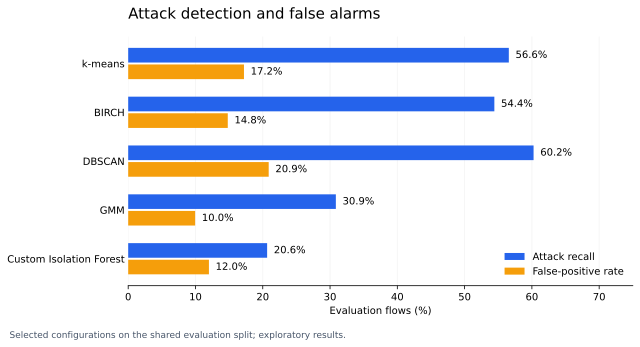

# Network Anomaly Detection

Can a model trained only on normal IoT traffic identify traffic from an attack?
This project compares clustering-based approaches on the **CIC IoT-DIAD 2024**
flow-based dataset, from data auditing and deterministic sampling to evaluation
by attack class.

**Python · NumPy · Pandas · scikit-learn · Julia**

The main work is in Python. An earlier Julia implementation is retained for
comparison. This is an experimental ML project, not a deployed intrusion
detection system.

## What I worked on

- Audited the CSV files, including malformed headers, and built repeatable,
  non-overlapping training and evaluation samples.
- Removed labels, IP addresses and record identifiers from model inputs. Fitted
  imputation and scaling on the training data only.
- Compared k-means, BIRCH, Gaussian mixtures, DBSCAN and OPTICS. Added a small
  custom Isolation Forest implementation and other novelty-detection baselines.
- Examined the trade-off between attack recall and false alarms, differences
  between attack classes, stability across seeds and larger training samples.
- Compared the unsupervised approach with supervised models in
  leave-one-attack-class-out experiments.

## Recorded results

The main split contains **30,000 benign training flows** and **26,000 evaluation
flows**: 12,000 benign and 2,000 from each of seven attack categories. The
preprocessing stage retained 72 features.



The chart is generated from the committed experiment CSVs. It shows selected
operating points, not an unbiased leaderboard. A detector with higher recall can
also generate more false alarms. Several parameter sweeps used the same
evaluation sample, so these results are exploratory.

[Results and methodology](docs/experiments.md) explain the configurations,
per-class results and limitations. The complete compact result tables are in
[results/](results/).

## Run locally

Use Python 3.12 or newer. From the repository root:

```bash
python -m venv .venv
# Windows: .venv\Scripts\activate
# Linux/macOS: source .venv/bin/activate
python -m pip install -r requirements.txt
```

Download the **Anomaly Detection - Flow based features** portion of
[CIC IoT-DIAD 2024](https://www.unb.ca/cic/datasets/iot-diad-2024.html).
Place the class directories under
`IoT-DIAD/Anomaly Detection - Flow based features/`, or set
`NETWORK_ANOMALY_DATA_DIR` to the directory containing `Benign`, `DDoS`, `DoS`
and the other attack folders. The original dataset layout is required.

```bash
python python/01_audit.py
python python/02_prepare_sample.py
python python/03_preprocess.py
python python/04_run_models.py
python python/12_run_clustering_extensions.py
```

Preparing samples scans the downloaded CSVs and may take a while. Run
`python python/04_run_models.py --only iforest` for a shorter model run after
sampling. Outputs are written to `samples/` and `results/`. Rerunning experiment
scripts can replace the recorded CSVs; use a separate clone for new experiments.

Raw data and sampled traffic records are **not included**. You can inspect the
results or run the tests without downloading the dataset:

```bash
python -m pip install -r requirements-dev.txt
python -m unittest discover -s tests -v
python -m ruff check python tests tools
python tools/build_results.py
```

## Repository map

| Directory | Contents |
|---|---|
| [python/](python/) | Numbered experiments and shared data/model code |
| [julia/](julia/) | Earlier implementation checkpoint |
| [results/](results/) | Recorded aggregate metrics, parameter sweeps and class-level recall |
| [docs/](docs/) | Methodology, experiment guide and generated comparison chart |
| [tests/](tests/) | Preprocessing, metric and model checks on synthetic inputs |

See the [experiment guide](python/README.md) for the remaining stages, including
source-aware sampling and optional CTGAN augmentation.

## Dataset acknowledgement

Dataset: Canadian Institute for Cybersecurity, University of New Brunswick,
[CIC IoT-DIAD 2024](https://www.unb.ca/cic/datasets/iot-diad-2024.html).

Associated publication: M. Rabbani et al., *Device Identification and Anomaly
Detection in IoT Environments*, IEEE Internet of Things Journal, December 2024.
The dataset and its authors are separate from this project's implementation.
